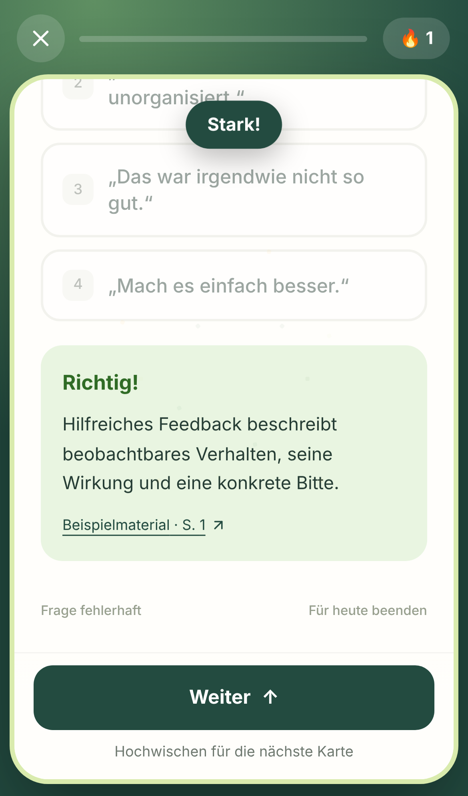
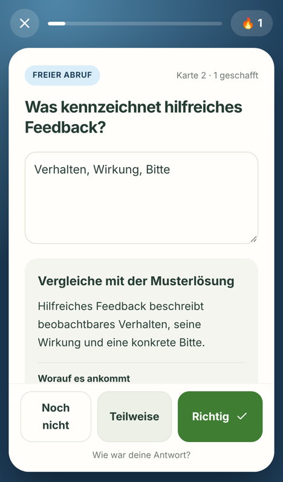

# Lernraum

Persönliche Lern-App fürs Studium (Wirtschaftskommunikation, HTW Berlin) – fürs iPhone gemacht, ~20 Minuten am Tag. Lernen fühlt sich an wie ein Feed: Karte antippen, beantworten, hochwischen, nächste Karte. Dahinter steckt aktives Abrufen mit einem Wiederholungsplan statt endlosem Konsum.

**Version 0.5.0** · [Changelog](CHANGELOG.md) · läuft komplett im Browser, kein Server, kein Konto

<p>




</p>

## Benutzen

Die App wird bei jedem Push automatisch auf **GitHub Pages** veröffentlicht: `https://<dein-github-name>.github.io/lernraum/`

- **iPhone:** Adresse in Safari öffnen → Teilen → **Zum Home-Bildschirm**. Danach startet Lernraum wie eine App, auch ohne Internet.
- **Aufgaben bekommen:** Material bei Claude oder ChatGPT hochladen, den [Aufgabenpaket-Prompt](docs/Aufgabenpaket-Prompt.md) verwenden, die JSON-Datei unter *Material* in Lernraum ziehen. Zum Ausprobieren: [docs/Beispiel-Aufgabenpaket.json](docs/Beispiel-Aufgabenpaket.json).
- **PDFs und Texte** lassen sich auch direkt importieren; daraus entstehen einfache Entwürfe zum Überarbeiten.

### Wo liegen meine Daten?

Nur auf dem Gerät, im Browser (IndexedDB) – nicht auf GitHub, nirgendwo sonst. Die Website ist öffentlich, aber jede Person, die sie öffnet, hat ihren eigenen, leeren Lernraum.

Daraus folgt:
- **Kein Abgleich zwischen Geräten.** Wechseln geht über *Einstellungen → Vollständiges Backup* und auf dem anderen Gerät *Backup-Datei auswählen*.
- **Regelmäßig Backups machen** (z. B. in iCloud Drive speichern). Die App erinnert daran, wenn das letzte Backup älter als eine Woche ist.
- **Websitedaten nicht löschen.** Safari kann Daten von Websites löschen, die man lange nicht öffnet – als App auf dem Home-Bildschirm passiert das deutlich seltener, ein Backup ersetzt es nicht.

## Was die App kann

- **Reel-Lernfeed** – Vollbildkarten, Antippen zum Antworten, Hochwischen/Scrollen für die nächste Karte, 🔥-Serien, Konfetti und automatisches Weiter bei richtigen Antworten. Details: [docs/Lernfeed-und-Papierkorb.md](docs/Lernfeed-und-Papierkorb.md)
- **Fünf Formate** – Single-Choice, Multiple-Choice, freier Abruf, Anwendung, Erklärkarte.
- **Wiederholungsplan `rules-v1`** – erfolgreiche, eigenständige Abrufe staffeln sich über 1, 3, 7, 14, 30, 60 Tage. Überspringen, Raten, Hilfe und Lesen zählen nicht als Erfolg.
- **Versionierte Inhalte** – Quellen und Aufgaben haben Versionen; Änderungen starten eine neue Wiederholungsspur, alte Antworten bleiben erhalten.
- **Papierkorb, Verlauf mit Korrekturen, vollständiges Backup/Restore, offline nutzbar.**

Bedienung im Detail: [docs/Bedienung.md](docs/Bedienung.md)

## Einmalig einrichten (GitHub Pages)

1. Repository auf GitHub veröffentlichen. **Es muss öffentlich sein** – GitHub Pages gibt es für private Repositories nur mit einem bezahlten Konto. Deine Lerndaten sind davon nicht betroffen, die liegen nie im Repository.
2. Auf GitHub: **Settings → Pages → Build and deployment → Source: „GitHub Actions“**.
3. Unter **Actions** den Lauf „Tests & GitHub Pages“ abwarten (ca. 1–2 Minuten). Danach ist die App unter der oben genannten Adresse erreichbar.

Ab dann gilt: Jede Änderung, die auf `main` gepusht wird, wird automatisch getestet und veröffentlicht.

## Entwickeln

Voraussetzung: Node.js ≥ 20 und npm.

```sh
npm install            # einmalig; danach package-lock.json mit committen
npm test               # Logik-, Paket-, Versions- und Backend-Tests
npm run dev            # bauen und unter http://localhost:4173 öffnen
npm run build          # nur bauen → dist/
npm run typecheck      # TypeScript
```

Stack: React 19 + TypeScript, gebündelt mit esbuild, PDF.js für PDF-Text, IndexedDB als Speicher, Service Worker für offline. Keine Server-Komponente.

```
components/learn-feed.tsx   Reel-Lernfeed (Gesten, Animationen, Serien)
components/lernraum.tsx     restliche Oberfläche (Heute, Material, Aufgaben, Verlauf, Einstellungen)
lib/local-api.mjs           „Backend“ im Browser: alle Befehle für Daten und Dateien
lib/browser-backend.ts      IndexedDB-Speicher und Anbindung an die Oberfläche
lib/core.mjs                Scheduler, Auswahl, Bewertung, Backup-Prüfung (reine Logik)
lib/package.mjs             Vertrag für JSON-Aufgabenpakete
lib/version.mjs             App-Version
web/                        Einstieg (main.tsx), Styles (app.css), Service Worker (sw.js)
public/                     Icons, Manifest, PDF.js
scripts/build.mjs           statischer Build
tests/                      Tests (node --test)
docs/                       Bedienung, Prompt, Konzept, Recherche, Chatverlauf, Archiv
```

Die Oberfläche spricht weiterhin `fetch('/api/data')` und `fetch('/api/file')` an; `lib/browser-backend.ts` beantwortet diese Aufrufe lokal. So ließe sich später wieder ein echter Server mit Geräteabgleich anschließen, ohne die Oberfläche umzubauen.

## Versionierung

- [Semantic Versioning](https://semver.org/lang/de/): `MAJOR.MINOR.PATCH`. Neue Funktion → MINOR, Fehlerbehebung → PATCH, inkompatibles Datenformat → MAJOR.
- Bei jedem Release `package.json`, `lib/version.mjs` und `CHANGELOG.md` anheben (der Test schlägt sonst fehl), committen und taggen:
  ```sh
  git tag -a v0.6.0 -m "Kurzbeschreibung" && git push --follow-tags
  ```
- Der Service Worker nutzt die Version als Cache-Namen – nach einem Release laden installierte Apps beim nächsten Öffnen mit Internet die neue Version.
- Inhalte in der App sind zusätzlich versioniert (Quellen `v1, v2 …`, Aufgaben mit Vorgängerverweis), unabhängig von der App-Version.

## Herkunft

Begonnen mit ChatGPT (auf dessen „Sites“-Hosting mit Anmeldung und Cloudflare-Datenbank, bis v0.4.0), seit v0.5.0 eigenständig. Konzept, Recherche zur Lernforschung und Umsetzungsspezifikation: `docs/konzept/`. Ursprünglicher Chatverlauf: `docs/verlauf/`. Alte Betriebsdoku: `docs/archiv/`.

## Offene Baustellen

1. Lernfeed und Home-Bildschirm-App auf echtem iPhone testen.
2. Optional: Geräteabgleich (z. B. Backup automatisch in iCloud Drive oder eigener Sync-Server).
3. `components/lernraum.tsx` weiter aufteilen, `any` durch echte Typen ersetzen.
4. Paketvorschau, Dublettenerkennung, Aktualisieren importierter Pakete.
5. Optional: OCR für Scans, KI-Bewertung offener Antworten mit Korrekturmöglichkeit.

## Lizenzen

PDF.js 5.6.205 unter Apache-2.0 (`public/pdf/LICENSE`). Für das Projekt selbst ist noch keine Lizenz festgelegt – ohne `LICENSE`-Datei gilt „alle Rechte vorbehalten“, auch wenn das Repository öffentlich ist.
