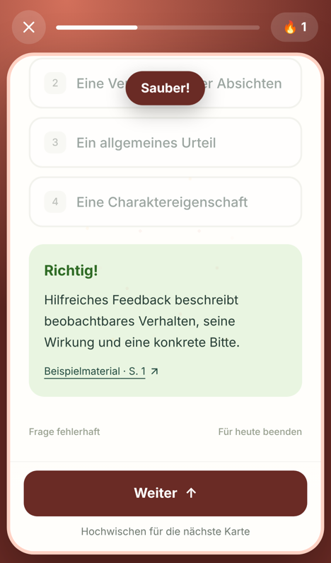
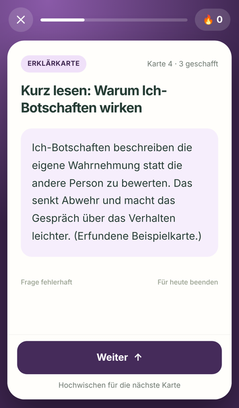

# Lernraum

Persönliche Lern-Web-App fürs Studium (Wirtschaftskommunikation, HTW Berlin) – fürs iPhone gemacht, ~20 Minuten am Tag. Lernen fühlt sich an wie ein Feed: Karte antippen, beantworten, hochwischen, nächste Karte. Dahinter steckt aktives Abrufen mit einem Wiederholungsplan statt endlosem Konsum.

**Version 0.4.0** · [Changelog](CHANGELOG.md)

<p>




</p>

## Sofort ausprobieren

`demo/index.html` im Browser öffnen – keine Installation nötig. Die Demo enthält die echte Oberfläche mit einem Browser-Adapter statt Server und erfundene Beispielkarten. Ein Beispiel-Aufgabenpaket liegt daneben (`demo/Beispiel-Aufgabenpaket.json`, unter *Material* hineinziehen).

Die Demo ersetzt nicht das Backend: keine Anmeldung, keine Synchronisation, kein PDF-Import. Keine echten Lerndaten darin ablegen.

## Was die App kann

- **Reel-Lernfeed** – Vollbildkarten, Antippen zum Antworten, Hochwischen/Scrollen für die nächste Karte, 🔥-Serien, Konfetti und automatisches Weiter bei richtigen Antworten. Details: [docs/Lernfeed-und-Papierkorb.md](docs/Lernfeed-und-Papierkorb.md)
- **Aufgabenpakete aus ChatGPT/Claude** – Material hochladen, mit dem [Aufgabenpaket-Prompt](docs/Aufgabenpaket-Prompt.md) JSON-Pakete erzeugen lassen, ins Uploadfeld ziehen. Bis 500 Aufgaben pro Datei, kein Doppelimport.
- **Fünf Formate** – Single-Choice, Multiple-Choice, freier Abruf, Anwendung, Erklärkarte.
- **Wiederholungsplan `rules-v1`** – erfolgreiche, eigenständige Abrufe staffeln sich über 1, 3, 7, 14, 30, 60 Tage. Überspringen, Raten, Hilfe und Lesen zählen nicht als Erfolg.
- **Versionierte Inhalte** – Quellen und Aufgaben haben Versionen; Änderungen starten eine neue Wiederholungsspur, alte Antworten bleiben erhalten.
- **Papierkorb, Verlauf mit Korrekturen, vollständiges Backup/Restore.**

## Projektstruktur

```
components/learn-feed.tsx   Reel-Lernfeed (Gesten, Animationen, Serien)
components/lernraum.tsx     restliche Oberfläche (Heute, Material, Aufgaben, Verlauf, Einstellungen)
lib/core.mjs                Scheduler, Auswahl, Bewertung, Backup-Prüfung (reine Logik)
lib/package.mjs             Vertrag für JSON-Aufgabenpakete
lib/version.mjs             App-Version
app/api/data/route.ts       authentifizierte Datenbefehle, Versionen, Papierkorb, Import, Restore
app/api/file/route.ts       geschützte Originaldateien
db/, drizzle/               Datenmodell und SQL-Migrationen (D1)
demo/                       eigenständige HTML-Demo + Adapter (demo/src/handoff-entry.tsx)
docs/                       Bedienung, Betrieb, Abnahme, Prompt, Konzept, Recherche, Chatverlauf
tests/                      Logik-, Paket-, Versions- und API-Tests
```

## Entwickeln

Voraussetzung: Node.js ≥ 22.13 und npm.

```sh
npm ci                 # Abhängigkeiten laut Lockfile
npm test               # Logik-, Paket- und Versionstests (ohne Server)
npm run typecheck      # TypeScript
npm run demo:build     # demo/index.html neu bauen
npm run dev            # Entwicklungsserver (siehe Hinweis)
```

Stack: React 19 / TypeScript, Vinext (Next-kompatibel auf Vite), Cloudflare Workers mit D1 (Datenbank) und R2 (Dateien). Die App ist ursprünglich auf ChatGPT „Sites“ gebaut worden; Anmeldung und Bindings kommen von dort. Für eigenes Hosting müssen Identitätsprüfung (`lib/server.ts`, `app/chatgpt-auth.ts`), Worker-Bindings und Deployment ersetzt werden. Lokale Migrationen, API-Tests und Veröffentlichung: [docs/Entwicklung-und-Hosting.md](docs/Entwicklung-und-Hosting.md) und [docs/Betrieb.md](docs/Betrieb.md).

## Versionierung

- [Semantic Versioning](https://semver.org/lang/de/): `MAJOR.MINOR.PATCH`. Neue Funktion → MINOR, Fehlerbehebung → PATCH, inkompatibles Datenformat → MAJOR.
- Bei jedem Release: `package.json`, `lib/version.mjs` und `CHANGELOG.md` anheben (der Test schlägt sonst fehl), committen, Tag setzen:
  ```sh
  git tag -a v0.5.0 -m "Kurzbeschreibung" && git push --follow-tags
  ```
- Datenbankänderungen nur als neue Datei in `drizzle/` – bestehende Migrationen nie ändern.
- Inhalte in der App sind zusätzlich versioniert (Quellen `v1, v2 …`, Aufgaben mit Vorgängerverweis), unabhängig von der App-Version.

## Herkunft und Dokumentation

Konzept, Recherche (Lernforschung) und Umsetzungsspezifikation liegen unter `docs/konzept/`, der ursprüngliche Chatverlauf mit ChatGPT unter `docs/verlauf/`. Ältere Dokumente beschreiben teils frühere Stände; maßgeblich ist der Code plus `CHANGELOG.md`.

## Offene Baustellen

1. Lernfeed auf echtem iPhone testen (Tastatur, lange Lösungen, langsames Netz, Safe Areas).
2. `components/lernraum.tsx` weiter aufteilen, `any` durch echte Typen ersetzen.
3. Mehrgeräte-Konflikte und Restore aus unterschiedlichen Ständen testen.
4. Paginierung für große Datenmengen, Paketvorschau, Dublettenerkennung.
5. Optional: OCR, KI-Bewertung mit Korrekturmöglichkeit, Offline-Modus.

## Lizenzen

PDF.js 5.6.205 unter Apache-2.0 (`public/pdf/LICENSE`), shadcn-Styles siehe `vendor/`. Für das Projekt selbst ist noch keine Lizenz festgelegt – ohne `LICENSE`-Datei gilt „alle Rechte vorbehalten“.
